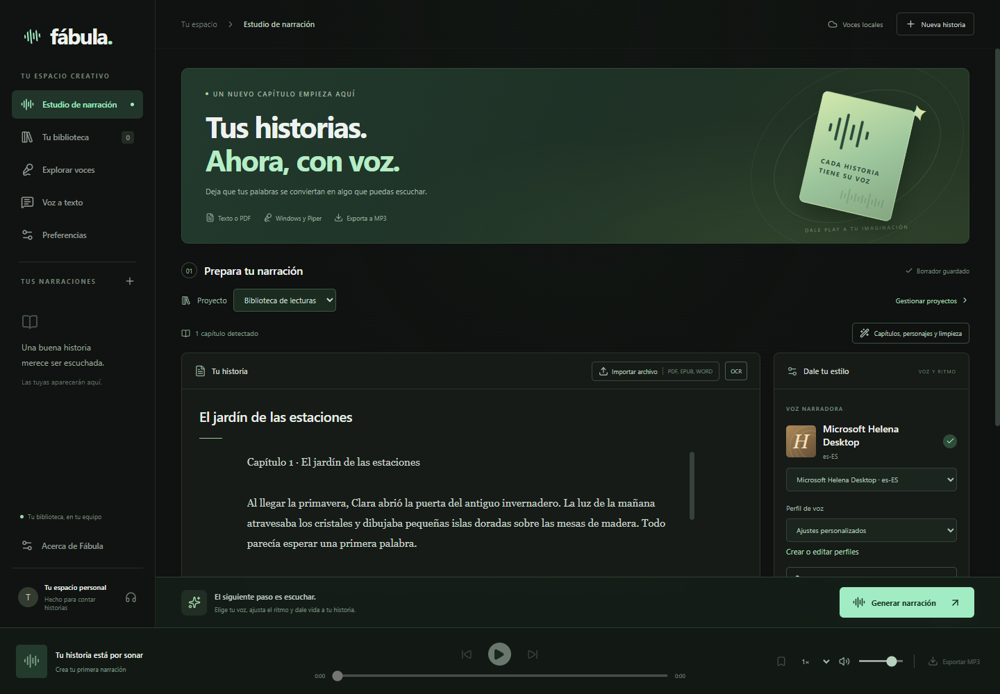
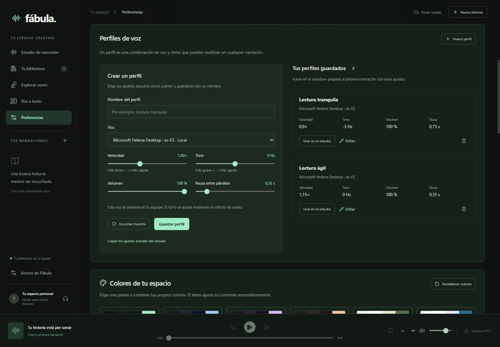
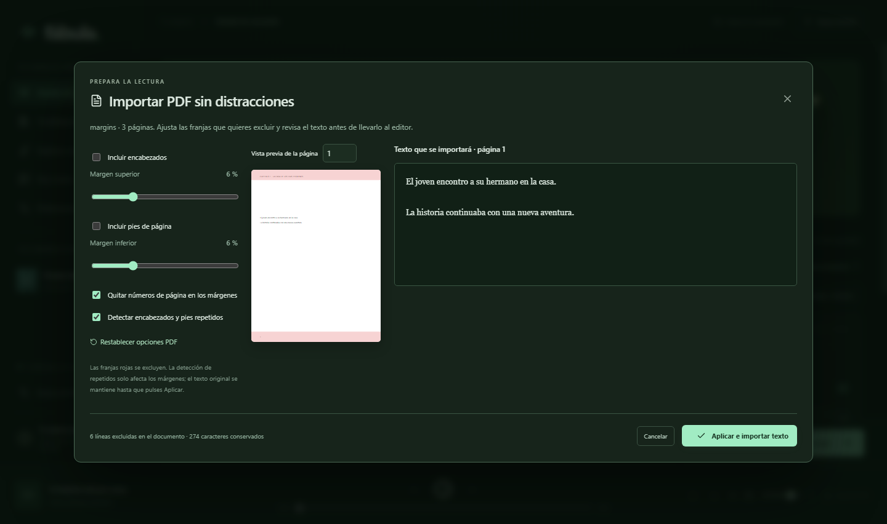
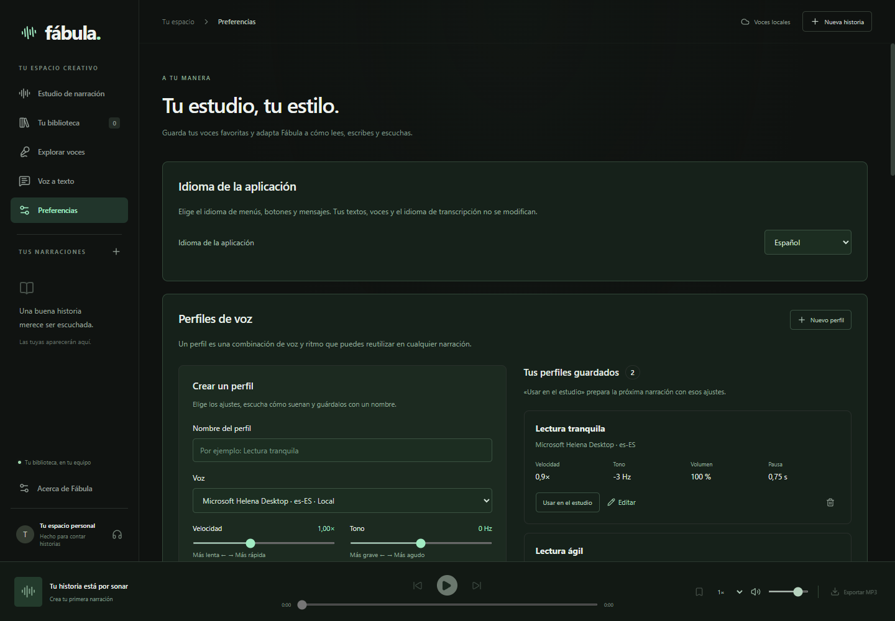

<p align="center">
  
</p>

<h1 align="center">Fábula</h1>

<p align="center"><strong>Tus textos, con voz.</strong><br>Un estudio de narración para escuchar novelas, documentos y audiolibros.</p>

<p align="center">
  <a href="https://github.com/NixonPiguave/fabula/actions/workflows/quality.yml"></a>
  <a href="LICENSE.txt"></a>
  
  
</p>

<p align="center">
  <a href="#qué-puedes-hacer">Funciones</a> ·
  <a href="#empezar">Empezar</a> ·
  <a href="#voces-y-privacidad">Voces y privacidad</a> ·
  <a href="#documentación">Documentación</a> ·
  <a href="#colaborar">Colaborar</a>
</p>



Fábula convierte la lectura en una experiencia que puedes adaptar a tu ritmo.
Pega un texto o importa un documento, elige una voz, ajusta la narración y
escúchala en la aplicación o expórtala como MP3. Organiza capítulos y lecturas
por proyectos, guarda tus ajustes favoritos y retoma la escucha donde la dejaste.

## Qué puedes hacer

| Función                      | Para qué sirve                                                                                      |
| ---------------------------- | --------------------------------------------------------------------------------------------------- |
| Narración de textos extensos | Divide el contenido en fragmentos y capítulos para generar audio y reanudar trabajos interrumpidos. |
| Importación de documentos    | Lee PDF, TXT, Markdown, DOCX, EPUB, HTML, ODT y RTF.                                                |
| Vista previa de PDF          | Ajusta márgenes y decide si conservar encabezados, pies y números de página antes de importar.      |
| OCR opcional                 | Extrae texto en español de imágenes y documentos escaneados.                                        |
| Perfiles de voz              | Guarda voz, velocidad, tono, volumen y pausas; escucha una muestra antes de aplicarlos.             |
| Pronunciación personalizada  | Define cómo leer palabras, abreviaturas y nombres sin alterar el documento original.                |
| Biblioteca y proyectos       | Agrupa narraciones, conserva marcadores y recupera tu posición de escucha.                          |
| Exportación de audio         | Guarda el MP3 completo o los capítulos por separado.                                                |
| Voz a texto                  | Transcribe grabaciones y dictados localmente con Whisper; exporta TXT, DOCX, SRT o VTT.             |
| Apariencia personalizable    | Elige temas y paletas o ajusta los colores del estudio y el reproductor.                            |

Los límites prácticos de una narración dependen del disco, la memoria y el
proveedor de voz. Revisa el resultado al importar PDF con columnas o diseños
complejos y al utilizar reconocimiento de texto o voz.

<details>
<summary>Ver perfiles de voz y opciones de importación</summary>







</details>

## Empezar

Cambia el idioma completo desde **Preferencias → Idioma de la aplicación**. La
elección se guarda y se aplica sin reiniciar. El instalador ofrece ambos idiomas
y usa esa elección para el primer inicio; una preferencia existente tiene prioridad.
El idioma de los libros, las voces y la transcripción se seleccionan por separado.

**Plataforma:** Windows 10/11 de 64 bits. **Idiomas de la interfaz:** español e inglés.

### Descargas

| Windows x64                                  | Descarga                                                                                                       |
| -------------------------------------------- | -------------------------------------------------------------------------------------------------------------- |
| Instalador con selección de idioma y carpeta | [Fabula-Instalador.exe](https://github.com/NixonPiguave/fabula/releases/download/v0.7.0/Fabula-Instalador.exe) |
| Portable, sin instalación                    | [Fabula.exe](https://github.com/NixonPiguave/fabula/releases/download/v0.7.0/Fabula.exe)                       |
| Integridad, fuentes y notas de la versión    | [Todos los archivos](https://github.com/NixonPiguave/fabula/releases/tag/v0.7.0)                               |

Ambos paquetes incluyen sus dependencias y no requieren Node.js ni Python.
El portable guarda los datos en `%APPDATA%/Fábula`. Los ejecutables no están
firmados digitalmente; Windows puede mostrar una advertencia de editor desconocido.
Comprueba los SHA-256 publicados antes de ejecutarlos.

Para ejecutar desde el código, instala **Node.js 24 o posterior** y Git:

```sh
git clone https://github.com/NixonPiguave/fabula.git
cd fabula
npm ci
npm run dev
```

`npm ci` descarga las dependencias y los runtimes necesarios para el desarrollo.
Los motores OCR, transcripción y Piper se descargan por separado desde la app
cuando los solicitas.

1. Pega un texto o selecciona **Importar**.
2. Revisa el contenido y elige una voz disponible.
3. Ajusta el ritmo o aplica uno de tus perfiles guardados.
4. Genera la narración, escúchala y exporta el audio cuando esté listo.

Las instrucciones completas están en la [guía de uso en TXT](GUIA_DE_USO.txt).

## Voces y privacidad

| Proveedor    | Procesamiento | Requisitos                                                                     |
| ------------ | ------------- | ------------------------------------------------------------------------------ |
| Windows SAPI | En el equipo  | Una voz compatible instalada en Windows; detección de 32 y 64 bits.            |
| Piper        | En el equipo  | Motor opcional y un modelo compatible `.onnx` con su configuración y licencia. |

La biblioteca, borradores, preferencias y modelos se guardan en
`%APPDATA%/Fábula`. La extracción de documentos, el OCR y la transcripción se
realizan localmente. No hay cuentas de Fábula ni telemetría propia implementada.
Las descargas opcionales contactan a sus respectivos proveedores.

Las voces de Windows dependen de los paquetes compatibles instalados. Cada
modelo Piper importado conserva sus propias condiciones de uso y distribución.

Consulta [Privacidad](PRIVACIDAD.txt), [Avisos de uso](AVISOS_DE_USO.txt) y
[Componentes de terceros](TERCEROS.txt) para conocer el alcance de cada opción.

## Desarrollo

Fábula utiliza **Electron, React y TypeScript**. El proceso principal valida
las entradas; la interfaz usa aislamiento de contexto y sandbox. La narración,
importación y transcripción se procesan en workers.

```sh
npm run format:check   # Formato compartido del código
npm test                # Pruebas unitarias
npm run build          # Avisos de licencias, tipos y compilación
npm run test:languages # Interfaz ES/EN, menús, diálogos y persistencia
npm run test:profiles  # Integración de perfiles; necesita una voz SAPI local
npm run package:all    # Generación local del portable y el instalador
```

Los archivos generados, modelos descargados y datos de usuarios quedan fuera
del repositorio. El empaquetado local no publica archivos automáticamente y los
ejecutables de desarrollo no están firmados digitalmente.

## Documentación

Las guías detalladas están en texto plano para poder abrirlas con cualquier editor.

| Documento                             | Contenido                                                    |
| ------------------------------------- | ------------------------------------------------------------ |
| [Guía de uso](GUIA_DE_USO.txt)        | Importación, voces, biblioteca, transcripción y compilación. |
| [Arquitectura](docs/ARQUITECTURA.txt) | Procesos, almacenamiento y proveedores.                      |
| [Calidad](docs/CALIDAD.txt)           | Comprobaciones básicas, integración y pruebas del paquete.   |
| [Contribuciones](CONTRIBUIR.txt)      | Cómo proponer cambios y validarlos.                          |
| [Seguridad](SEGURIDAD.txt)            | Cómo comunicar una vulnerabilidad de forma privada.          |
| [Distribución](docs/DISTRIBUCION.txt) | Preparación de versiones, licencias y empaquetado.           |

## Colaborar

Puedes [reportar un problema](https://github.com/NixonPiguave/fabula/issues/new/choose),
proponer mejoras o enviar una pull request. Describe el caso de uso y acompaña
los errores con pasos reproducibles y ejemplos ficticios, evitando documentos
y grabaciones personales.

Lee la [guía de contribución](CONTRIBUIR.txt) y las
[normas de convivencia](CONVIVENCIA.txt) antes de participar. Para problemas de
seguridad utiliza el [canal privado de GitHub](https://github.com/NixonPiguave/fabula/security/advisories/new).

## Licencia

El código propio de Fábula se distribuye bajo **GPL-3.0-or-later**.
Consulta el [texto íntegro de la licencia](LICENSE.txt).

Las licencias del programa no sustituyen las condiciones de los textos, voces,
servicios o modelos que utilices. Los avisos originales de los paquetes se
conservan en [Licencias de componentes](LICENCIAS_DE_COMPONENTES.txt).

## English


Fábula is a desktop narration studio for Windows with complete Spanish and English interfaces. Turn novels
and documents into spoken audio, organize reading projects, export MP3 files,
and transcribe recordings locally. Windows voices and imported Piper models run
on your computer. Narration text is processed locally. Switch the interface language in **Preferences → Application language**.
The installer language initializes new profiles; existing preferences are kept.
Changing the interface does not translate your manuscript or change your voice.

Download the [Windows installer](https://github.com/NixonPiguave/fabula/releases/download/v0.7.0/Fabula-Instalador.exe) or
[portable application](https://github.com/NixonPiguave/fabula/releases/download/v0.7.0/Fabula.exe) directly from GitHub Releases.
The release includes checksums, corresponding component sources and original notices.
The executables are unsigned. Source code is licensed under GPL-3.0-or-later.
Read the [English user guide](docs/en/USER_GUIDE.txt),
[privacy notice](docs/en/PRIVACY.txt), [usage notices](docs/en/USAGE_NOTICES.txt)
and [third-party notices](docs/en/THIRD_PARTY.txt).
